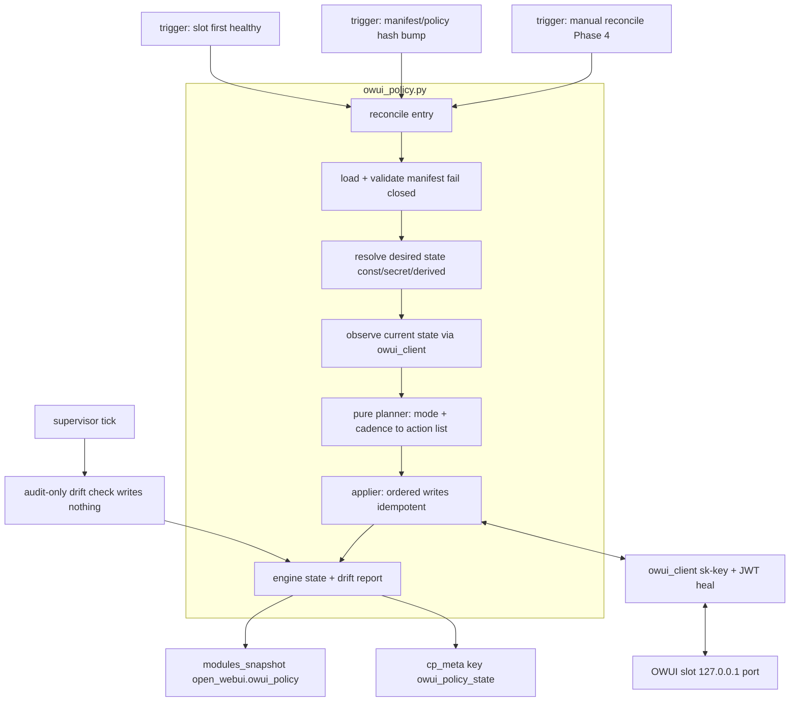

# M6.3b Phase 3 — `owui_policy` engine: implementation plan

> **Milestone design artifact.** Phase plan for M6.3b Phase 3; superseded by
> `DESIGN.md` for how the appliance behaves today.

Status: **Phase 3 landed 2026-10-07** (`make test` 316 green; `make test-qemu`
green ×2 — boot-revert + audit-pending two-run proof). Approved at the gate of
2026-10-06 with decisions recorded in §12.
Spec source of truth at the time of writing: the M6.3b section of `DESIGN.md`,
now [`OWUI-DURABLE-CONFIG-M63B.md`](./OWUI-DURABLE-CONFIG-M63B.md) — this plan
implements it, it does not re-open it. Where this plan and that record (or
`DESIGN.md` as built) conflict, they win and this document gets corrected.

Phase status: Phase 1 (service identity), Phase 2 (the persistence flip) and
Phase 3 (the policy engine) are landed and validated (`make test` +
`make test-qemu` ×2 green each). Phase 3 landed with three corrections found
only in the live guest: `users/all` returns `{"users": [...], "total": N}`
(bare-list fakes hid the bug); audit ticks must not rewrite the LKG snapshot;
and env-floor staleness uses a CP-owned `LEMONSEED_OWUI_ENV_GEN` marker because
retired-key absence checks are impossible against the image-baked `Config.Env`
(§8). Phase 4 is portal visualization + enforce-mode guards + reset window;
Phase 5 is LiteLLM friendly models + SearXNG/ComfyUI as manifest entries.

## 1. Scope

**In (Phase 3):**

| # | Deliverable | Touches |
|---|-------------|---------|
| 3.1 | Versioned manifest `control-plane/owui-policy.json` (day-one content §4) | new file |
| 3.2 | Engine `control-plane/owui_policy.py`: load/validate, resolvers, pure planner, applier, entity handlers, engine state (§5) | new file |
| 3.3 | Client extensions: `sk-` key lifecycle, api-path indirection, entity CRUD methods (§6) | `owui_client.py` |
| 3.4 | Supervisor integration: reconcile worker + triggers + module-state fields (§7) | `modules.py` |
| 3.5 | Env shrinks to the bootstrap set; `_policy_env_ok` → `_bootstrap_env_ok` (§8) | `modules.py`, tests |
| 3.6 | Packaging: manifest + engine installed with the CP, runtime path resolution (§9) | `nixos/modules/control-plane.nix` |
| 3.7 | Tests: unit inventory + QEMU extensions (§10) | `test_*.py`, `scripts/qemu-api-smoke-test.sh` |
| 3.8 | Last-known-good config snapshot + chat-ready gate (D1): `owui_config_lkg` in the **CP** schema (outside OWUI's DB), `owui_policy.ok` joins the iframe's Getting-Ready conditions | `owui_policy.py`, `db.py`, `stub.py` shell |

**Out (explicitly later):**

- Portal config tree, ownership badges, rollups → Phase 4 (consumes the
  snapshot + manifest only; the engine exposes what it needs).
- Enforce-mode nginx guards + `%CP_OWUI_ID%` runtime rendering → Phase 4.
  The manifest's `guards` list ships **advertise-only** in Phase 3.
- “Reset chat interface settings” maintenance window → Phase 4.
- Identity-event triggers (user create/delete/admin-group change → immediate
  push; demotion via `users/{id}/update`) → Phase 4 (needs the portal
  lifecycle handlers as callers; the Phase-3 boot reconcile converges anyway).
- `groups` entity handler → Phase 4 (CP already has `groups`/`user_groups`
  tables; sign-in already syncs groups by name, so reconciliation is
  belt-and-braces, not urgent).
- LiteLLM friendly models, SearXNG/ComfyUI entries → Phase 5.

## 2. Architecture



The legibility rule from DESIGN.md holds: **every behavior the CP exhibits
toward OWUI must trace to a manifest entry**. Python contains mechanisms
(handlers, resolvers, planner), never policy (values, modes, paths).

## 3. Manifest schema v1 (validation contract)

`control-plane/owui-policy.json`, shipped read-only in SquashFS beside the CP
sources. JSON, parsed with stdlib `json`.

```json
{
  "version": 1,
  "owui": { "min_version": "0.11.0" },
  "settings": { "entries": { "<dotted-registry-key>": {
      "value": "<const | {\"secret\": \"KEY\"} | {\"derived\": \"name\">",
      "mode": "initial_setup | managed",
      "cadence": "at_boot | on_upgrade | manual   (required iff managed)",
      "optional": false,                                  (default; see D1)
      "reason": "human sentence surfaced in the portal"
  } } },
  "entities": {
    "models": { "mode": "selective_management", "own_by": "id",
                "own_ids": ["lemonseed-ai", "lemonseed-ai-filtered"],
                "reserved_name_regex": "^Lemonseed.*$",
                "reason": "..." },
    "users":  { "mode": "full_management", "source": "cp.users",
                "scope": ["membership", "is_admin"],
                "never_touch": ["%SERVICE_ACCOUNT_ID%"],
                "reason": "..." }
  },
  "guards": [ { "path": "POST /api/v1/auths/add", "mode": "advertise",
                "reason": "Household accounts are created in Lemonseed" } ],
  "api": { "config.export": "GET /api/v1/configs/export", "...": "..." }
}
```

Validator rules (fail = whole manifest rejected, engine refuses to write
anything, last-good state reported in snapshot):

1. Unknown top-level keys, unknown entry fields, unknown modes/cadences →
   reject. (Strictness is what makes the file safe to extend later.)
2. `cadence` required for `mode: managed`, forbidden otherwise.
3. `settings.entries` keys must match `^[a-z0-9_.]+$` (dotted registry keys).
4. `entities` kind must be registered in the handler registry (unknown kind →
   reject — the file must never silently no-op).
5. `guards[].path` = `METHOD /regex` (regex path portion compiles);
   `%PLACEHOLDER%` tokens limited to the known set.
6. `version` is an int; the engine also stores a `policy_hash`
   (sha256 over the file bytes) — *the hash, not the version, gates
   `on_upgrade` writes*, so in-tree value tweaks without a version bump still
   re-assert after `lemonseed-update`. Bumping `version` is for API-shape
   compatibility (paired with `owui.min_version`).
7. OWUI version gate: engine refuses writes when
   `installed_owui_version < min_version` (drift report only) — an OWUI pin
   bump is an API-compat event per the risk table.

**Adding a rule is a one-entry JSON diff** — no Python. Adding a *derived
value* is a 3-line resolver-registry entry. Adding an *entity kind* is one
handler class (§5.4).

## 4. Day-one manifest content

Registry key names below are **verified against the v0.11.0 tag**
(`backend/open_webui/config.py` `DEFAULT_CONFIG`). Values mirror today's
`enrich_open_webui_secrets()` payload exactly, so the transition is a no-op on
deployed boxes (their config tables were already seeded from these env values
when Phase 2 shipped). Modes/cadences follow the decision register; entries
marked 📋 are the per-method calls to confirm during build (they are
mechanical, not architectural).

**Stays bootstrap env (not a registry key at all — verified):**
`WEBUI_NAME`, `ENABLE_VERSION_UPDATE_CHECK`, `OFFLINE_MODE` are read from env
at import and are absent from `DEFAULT_CONFIG`; together with `DATABASE_URL`,
`WEBUI_SECRET_KEY`, `WEBUI_AUTH` + 4 trusted headers they form the bootstrap
set (the gate draft also listed `RESET_CONFIG_ON_START` as an escape hatch —
superseded: the reset lands as the Phase-4 DB-window flow, not env; DESIGN.md's
table now matches).

**Settings entries (managed unless noted):**

| Config key | Value | Mode / cadence | Rationale (short `reason` source) |
|---|---|---|---|
| `ollama.enable` | `false` | managed / `at_boot` | no Ollama in the appliance; egress surface closed |
| `direct.enable` | `false` 📋 | managed / `at_boot` | users must not point OWUI at arbitrary endpoints |
| `openai.enable` | `true` | managed / `at_boot` | Lemonade (lemond) is the OpenAI-compatible upstream |
| `openai.api_base_urls` | `{"derived":"lemond_base"}` as list | managed / `at_boot` | chat traffic goes to lemond and nowhere else; whole list via raw import (D5) |
| `openai.api_keys` | `{"secret":"OPENAI_API_KEY"}` as list | managed / `at_boot` | lemond API key (secret → masked in portal) |
| `openai.api_configs` | exactly one connection entry 📋 | managed / `at_boot` | day one: exactly one model connection |
| `web.search.enable` | `false` | managed / `at_boot` | no SearXNG sidecar yet; egress off |
| `image_generation.enable` | `false` | managed / `at_boot` | no ComfyUI sidecar yet |
| `images.edit.enable` | `false` | managed / `at_boot` | ditto |
| `ui.enable_community_sharing` | `false` | managed / `at_boot` | household content stays home |
| `auth.enable_api_keys` | `true` | managed / `at_boot` | CP machine credential + user self-service endpoints |
| `auth.api_key.endpoint_restrictions` | `true` | managed / `at_boot` | CP key scoped to the manifest's `api` path set |
| `auth.api_key.allowed_endpoints` | derived from `api` map 📋 | managed / `at_boot` | keep the key's blast radius = the contract |
| `user.permissions` | one JSON object (below) | managed / `at_boot` | default permissions incl. `features.api_keys: true`; workspace off |
| `automations.enable` | `true` | managed / `at_boot` 📋 | M6.3a policy |
| `notes.enable` | `true` | managed / `at_boot` 📋 | M6.3a policy |
| `memories.enable` / `memories.system_context.enable` | `true`, `true` | managed / `at_boot` 📋 | M6.3a policy |
| `channels.enable` | `false` | managed / `at_boot` | until we seed a shared “everyone” channel |
| `task.autocomplete.enable` | `false` | managed / `at_boot` 📋 | M6.3a policy |
| `ui.enable_signup` | `false` | managed / `at_boot` 📋 | accounts are created in Lemonseed |
| `ui.default_models` | `[]` | `initial_setup` | first-boot default only |
| `models.default_metadata` | current `DEFAULT_MODEL_METADATA` | `initial_setup` | builtin-tools off until curated sources |
| `models.default_params` | current `DEFAULT_MODEL_PARAMS` (Lemonseed system prompt, `function_calling: legacy`) | `initial_setup` | seed identity prompt; per-model edits are the user's |

`user.permissions` is a **single** registry key (the `USER_PERMISSIONS_*`
env-var family folds into it) — one entry, one value object reproducing
today's effective dict: `features.api_keys: true`, `features.automations:
true`, `features.notes: true`, `features.memories: true`,
`features.channels: false`, workspace `models/knowledge/prompts/tools/skills:
false`, defaults per current payload.

**Entities:** `models` (`selective_management`, own ids
`lemonseed-ai`/`lemonseed-ai-filtered` — Phase 5 writes real LiteLLM-backed
definitions; day one the ids may have **zero** owned entries, the kind ships
with ownership rules armed) and `users` (`full_management`, scope
membership + is_admin, additive-only loop per DESIGN).

**Guards:** the four DESIGN-sketched paths, all `"mode": "advertise"` in
Phase 3 (portal shows them; nothing enforced at nginx until Phase 4).

**API map:** the day-one endpoint table from DESIGN.md (§“Day-one
interface”), one logical name per row.

## 5. Engine internals (`owui_policy.py`)

Single module, stdlib only, four layers with hard seams so each is testable
in isolation:

### 5.1 Load + validate

`load_manifest(path) -> Manifest | ManifestError`. `Manifest` is a frozen
dataclass tree (no dicts leaking past validation). The engine holds the
**last-good** manifest; a bad file on disk means: keep serving the old
manifest's state, record `manifest_error` in the snapshot, write nothing.
Runtime path: `Path(__file__).with_name("owui-policy.json")` (packaged beside
the CP sources — §9).

### 5.2 Resolvers

```python
RESOLVERS: dict[str, Callable[[], Any]] = {
    "lemond_base":     lambda: LEMONADE_BASE,          # modules.LEMONADE_BASE
    "lemond_api_key":  lemonade_api_key,               # existing helper
    "api_paths_allow": ...,  # sorted set from manifest api map (for key restriction)
}
```

Value resolution order per entry: `const` → literal; `{"secret": K}` →
`_module_credentials("open_webui")[K]`; `{"derived": name}` → registry.
Resolution failure (e.g. key missing pre-provisioning) = entry skipped **with
a drift-report line**, never a partial write.

### 5.3 Planner — pure, the whole semantics surface

`plan(manifest, desired, observed, engine_state, trigger) -> list[Action]`

No I/O. Action = dataclass `{kind, op, key_or_ref, before, after, why, mode,
cadence_gate}` where `op ∈ {create, update, delete, sweep, skip}`. This table
is the entire mode semantics (mirrors DESIGN §“Interaction modes”):

| Kind × mode | observed vs desired | action |
|---|---|---|
| scalar `initial_setup` | row missing | create (backfill via `config.import`) |
| scalar `initial_setup` | row present | skip (forever; even if != our seed) |
| scalar `managed` | differs, cadence fires | update |
| scalar `managed` | differs, cadence gated | skip + drift note |
| scalar `managed` | equal | skip |
| collection `selective_management` | owned id missing | create (CP id verbatim) |
| collection `selective_management` | owned id differs | update |
| collection `selective_management` | foreign entity, reserved name | **sweep** (delete + portal-log entry) |
| collection `selective_management` | foreign entity, other name | skip (never touch) |
| collection `full_management` (users) | CP member missing in OWUI | create (`auths/add`) — or adopt existing by email |
| collection `full_management` (users) | role drift vs CP admin-group | update (`users/{id}/update`) |
| collection `full_management` (users) | OWUI account not in CP | **skip + drift entry** — loop never deletes (§11 rule) |
| service account (any) | anything | only re-assert `role=admin`; never modify/delete |

Cadence firing: `at_boot` fires on the first reconcile after a slot goes
healthy; `on_upgrade` fires when `policy_hash != state.last_policy_hash`;
`manual` only via explicit call. Writes for one trigger are **ordered**:
auth/keys wiring → settings → entities, so later steps can't depend on
earlier ones (fail-safe on partial failure: rerun next tick).

### 5.4 Entity handlers (extensibility point)

```python
class EntityHandler(Protocol):
    kind: str
    def observe(self, client) -> dict[str, dict]      # id -> entity (canonical)
    def desired(self, conf, ctx) -> dict[str, dict]   # from CP truth
    def apply(self, client, action) -> dict[str, Any] # create/update/delete one
```

`ENTITY_KINDS = {"models": ModelsHandler(), "users": UsersHandler()}` —
register a new kind (groups, knowledge sources, tools…) with one class + one
registration line; the planner's table above is kind-agnostic. Day-one:

- **`ModelsHandler`** — `observe` = `models_admin_list`
  (`GET /api/v1/models/export`, never `models/list`); `desired` day one =
  `own_ids` resolved via optional `definition_ref` (empty until Phase 5);
  sweep compares display names case-insensitively against
  `reserved_name_regex`. `models/sync` is **unreachable** while the kind is
  `selective_management` (planner emits it only under `full_management`).
- **`UsersHandler`** — `observe` = `users_all` (+ service account id known
  from Phase 1); `desired` = CP users from `auth.py`'s user table (email +
  is-admin from admin group); apply-create via `auths/add` with trusted
  headers (auto-provisions identity fields), role fixes via
  `users/{id}/update`. Never deletes (delete lives only in the Phase-4
  portal handler).

### 5.5 Engine state + drift report

Persisted via `db.cp_set_meta("owui_policy_state", {...})` / `cp_get_meta`
(CP Postgres). **No second persistence path (decided, D2):** state is only
read/written *inside* `reconcile()`, which never runs unless OWUI is healthy —
and OWUI healthy ⇒ Postgres healthy. If a state read/write fails anyway (PG
flap mid-run), the run records the error in the in-memory snapshot, treats
`on_upgrade` eligibility as *undeterminable* (writes nothing that needs the
last-hash comparison — fail-safe), and retries on the next tick.

```json
{ "manifest_version": 1, "policy_hash": "sha256:…",
  "owui_version": "0.11.0", "last_reconciled": "…",
  "last_trigger": "at_boot", "last_error": null,
  "drift": { "ok": 41, "fixed": 3, "pending": 1,
             "entries": [ {"key": "web.search.enable", "found": true,
                            "want": false, "mode": "managed",
                            "cadence": "at_boot", "state": "fixed"}, … ] } }
```

`modules_snapshot()["open_webui"]["owui_policy"]` exposes exactly this shape
(plus `manifest_error`) — that is the data Phase 4's portal tree joins with
the manifest for badges/rollups/tooltips.

**Last-known-good config snapshot (D1 mitigation, §12):** after each run where
`state=ok` (all required entries applied), the engine writes the **full
`config.export` map** + `policy_hash` + `owui_version` + timestamp into
`owui_config_lkg` — a **CP-schema table** (via `db._apply_cp_schema`), i.e.
deliberately *outside* the OWUI database so it survives a broken/wiped OWUI
DB. Snapshot is a single slot (LKG only, no history): the export map is
exactly what `config.import` replays, so restore = import LKG map →
re-reconcile manifest on top, no pg_dump mechanics. Secrets ride along
(same trust domain as module secrets; portal masks them). Full-DB snapshots
(chats/users) are a general backup concern — §11 backlog, see D1.

### 5.6 Reconcile entry point

`reconcile(port, trigger) -> dict` — never raises (module boundary rule):
acquires its own non-blocking `_reconcile_lock` (**separate** from the
`ensure_open_webui` container lock; slots share the DB, one reconciler per
**module**), requires: module ready + service identity ready + version gate
green. Sequence per run: load → resolve → observe (batch: `config_export` +
entity lists) → plan → apply → persist state. The **audit-only** variant runs
the same path with `plan` filtered to zero writes; used by supervisor ticks
and the pre-cutover candidate-slot check (DESIGN).

## 6. Client extensions (`owui_client.py`)

1. **API-path indirection**: `OwuiClient(base, ..., api_map=None)`;
   `client.call("config.export")` resolves verb+path from the manifest map,
   falling back to built-in defaults that mirror the day-one table. No route
   strings hardcoded at call sites (DESIGN: a pin bump becomes a manifest
   diff).
2. **Auth = `sk-` key with JWT healing**: at provision time (first healthy,
   identity ready): sign in via JWT (Phase-1 path) → ensure
   `auth.enable_api_keys`/restrictions/allowed_endpoints are as the manifest
   demands → `POST /api/v1/auths/api_key` mint → persist key in module
   secrets (`OWUI_CP_API_KEY`). All engine calls use `Authorization: Bearer
   sk-…`. On 401 with an `sk-` key: one re-mint (JWT path), store new key;
   on 401 with the JWT: one re-signin (already implemented). If
   endpoint-restriction lockout ever breaks the key, the same recovery path
   works via JWT — the lock is recoverable by construction.
3. **New methods** per day-one table: `config_export`, `config_import`,
   `config_namespace`, `models_admin_list`, `model_create/update/delete`,
   `models_sync` (guard-railed: refuses to fire unless caller asserts the
   kind is `full_management`), `users_all`, `user_update`, `user_delete`
   (docstring: *loop must never call*), `user_create` (`auths/add`),
   `api_key_create/revoke` (`auths/api_key`), `groups_*` stubs (Phase 4).

## 7. Supervisor integration (`modules.py`)

- `ensure_owui_module()` (existing worker tick) gains, after the existing
  ready/identity path:
  1. **first-healthy / hash-bump** → `owui_policy.reconcile(trigger=...)`
     inline in the worker thread (bounded: OWUI ops are localhost, seconds);
  2. otherwise, every N ticks (~5 min) → `reconcile(audit_only=True)`.
- Trigger inputs: `_policy_trigger` computed from
  `(slot_generation, policy_hash_seen)` — slot generation bumps on
  recreate/cutover (already detectable: active port flips + ready edge);
  hash bump = manifest file hash != `state.policy_hash`.
- New snapshot fields under `open_webui`: `owui_policy` (§5.5). The existing
  recreate-after-failed-probes lifecycle is untouched; reconcile never
  triggers recreates, and env drift on now-DB-managed keys never forces one
  either (§8).
- **Chat-ready gate (D1):** the shell's iframe gate joins a third condition —
  `open_webui.owui_policy.ok` alongside `http_ready` and `chat.state=ready`.
  A non-reconciled OWUI stays behind the Getting-Ready bubble ("Preparing
  chat interface…") with a detailed state for admins; users never see a
  blank-slate OWUI. Recovery actions (retry / restore LKG / roll back
  release) surface in the Phase-4 portal; Phase 3 ships the gate + state +
  LKG storage + the restore function, prompt-free.
- Fresh-boot ordering: identity (Phase 1) → reconcile → chat-ready/iframe
  unchanged. Reconcile failure **never** blocks the module state machine —
  it surfaces as `last_error` + drift (see decision D1).

## 8. Env shrink (the second half of the flip)

`enrich_open_webui_secrets()` payload → bootstrap set only:
`DATABASE_URL`, `WEBUI_SECRET_KEY`, `WEBUI_AUTH` + 4 trusted headers,
`OFFLINE_MODE`, `WEBUI_NAME`, `ENABLE_VERSION_UPDATE_CHECK` (+ the
`LEMONADE`/`OPENAI_*` secrets stay *as secret storage*, but the `OPENAI_API_*`
**env entries for OWUI** go away — the key now flows into
`openai.api_keys` via manifest `secret:OPENAI_API_KEY`).
`_POLICY_ENV_KEYS`/`_policy_env_ok` → `_BOOTSTRAP_ENV_KEYS`/`_bootstrap_env_ok`.
Staleness detection was **changed during build** (QEMU proved the plan wrong):
the retired-key absence mechanic is unsatisfiable because the OWUI v0.11.0
image bakes `OLLAMA_BASE_URL`, `OPENAI_API_KEY`, `OPENAI_API_BASE_URL` and
`WEBUI_SECRET_KEY` into `Config.Env`, and `--env-file` merges over image ENV —
absence can never hold and the CP blue/green stormed forever. Replacement: the
env file also carries a CP-owned generation marker (`LEMONSEED_OWUI_ENV_GEN=2`);
`_bootstrap_env_ok` requires marker match + exact bootstrap match (bump the
value on any floor change). `lemond` still reads `OPENAI_API_KEY` from the
secrets file directly — unchanged.

**Why atomic in Phase 3 is safe:** deployed disks already seeded their config
tables from today's env values (Phase 2); removing the env keys changes no
observed value. A fresh install relies on the reconciler for non-bootstrap
values — covered by decision D1.

Obsolete-test list: `test_enrich_secrets` env asserts beyond bootstrap are
deleted (their replacements are manifest unit tests asserting the *same
values* from the manifest — the policy survives the test in new clothing);
`test_policy_env_ok_retired_key_*` became the env-generation-marker tests
(`test_bootstrap_env_gen_marker_force_recreate`, incl. image-baked-key
regression coverage); smoke `ollama.enable`/`openai.enable` export asserts
stay (proven again through the new path).

## 9. Packaging (`nixos/modules/control-plane.nix`)

Add `owui_policy.py` **and `owui-policy.json`** to the `cp` install list
(the Phase-1 missing-file crash-loop is the precedent — unit tests import
from source and will not catch a nix omission; the QEMU run will).
`python3 -m compileall` covers `owui_policy.py`; the JSON needs no build
step but must land in the same dir as the modules so
`Path(__file__).with_name(...)` resolves. Smoke asserts the manifest is
loadable by having the reconciler report `manifest_version` in the snapshot.

## 10. Testing plan

**Tier A (`make test`, mock all HTTP):**

| Area | Cases |
|---|---|
| manifest | valid fixture loads; unknown key/mode/cadence/entity-kind rejected; missing cadence rejected; hash != last ⇒ on_upgrade fires; version gate refuses on old OWUI |
| resolvers | const/secret/derived each resolve; missing secret ⇒ skip + drift, never partial write |
| planner (pure) | one table-driven test per row of the §5.3 table, incl. cadence gating and ordered ops |
| handlers | models sweep only on reserved-name collision (case-insensitive), never touches foreign names; users adopt-by-email, role push, never-delete-unknown; service account excluded from sweep/delete |
| applier | actions applied in order; mid-run failure ⇒ state records partial run, next run converges (idempotence); `optional` entry failure ⇒ warning only, `state` can still reach `ok` |
| LKG | snapshot written only on `state=ok`; restore gated on matching `owui_version`; corrupt/missing LKG row ⇒ step skipped, ladder continues |
| gate | `owui_policy.ok=false` keeps the shell's iframe-gate condition false (snapshot plumbing; shell JS unchanged) |
| client | sk-key happy path; 401 ⇒ re-mint once; api_map routing; `models_sync` refuses under selective_management |
| modules | reconcile not entered pre-identity / post-version-gate-fail; audit tick writes nothing; reconcile error leaves module state untouched |
| removed | M6.3a env-payload asserts per §8; `_bootstrap_env_ok` replaces policy-env tests |

**Tier C (`make test-qemu`, extend the existing OWUI section):**

1. Reconcile proof: `PUT` a managed value out-of-band via the API as admin
   (e.g. flip `web.search.enable=true` through `configs/import`) → force
   reconcile tick (write a marker or wait ≤5 min under KVM — better: the
   smoke can restart nothing, just wait one audit tick then one at-boot on
   run 2; simplest deterministic hook: bump is hard from smoke, so assert
   **audit drift reports it**, then next-run `at_boot` fixes it and run-2
   export shows `false` again). Two-run pattern like the Phase-2 marker.
2. `initial_setup` proof: smoke deletes the `ui.default_models` row? (can't
   delete via API — instead: `configs/import` a different value, wait a tick;
   value **must not** revert because `initial_setup`.) Asserts the *negative*
   behavior is real.
3. Env floor: `docker inspect` env contains **only** bootstrap keys (assert
   absence of `ENABLE_WEB_SEARCH` etc. — proves §8 in the live container).
4. sk-key plumbing: reconciler state reports `key_ready`; direct-to-slot call
   with the stored key from the guest (localhost curl) succeeds; a path
   outside the allowed set is refused by OWUI itself.
5. `service_ready` + existing Phase-1/2 assertions stay green unchanged.
6. Gate + recovery: after successful boot reconcile, snapshot reports
   `ok` and LKG row exists (`SELECT` via guest psql or via an exposed
   snapshot field); corrupting intent is hard to do from smoke without debug
   hooks, so the restore path itself is unit-tested only (QEMU would need a
   broken manifest in the image — covered by Tier-A fixtures instead).

Gate: `make test` green, `make build-qemu`, `QEMU_API_TIMEOUT=1200
make test-qemu` **twice** (two-run persistence/drift pattern). Bare-metal
checkpoint offered after step 4 lands: watch `lemonseed-update` reconcile on
the NVIDIA box and confirm GUI edits to a `managed` key revert at next boot.

## 11. Execution order (each step ends green on `make test`)

1. Manifest v1 + loader/validator + unit tests *(values cross-checked against
   the current env payload so the flip is provably a no-op)*
2. Planner + resolvers + state store + unit tests (pure, no HTTP)
3. Client extensions + mocked transport tests
4. Handlers + applier + unit tests
5. `modules.py` worker wiring + snapshot + unit tests
6. Env shrink + `_bootstrap_env_ok` + obsolete-test surgery
7. Nix packaging + QEMU smoke extensions + two full runs
8. DESIGN.md ticks: checklist items 2–4 + bootstrap-table corrections
   (`WEBUI_NAME`, `ENABLE_VERSION_UPDATE_CHECK`) + this doc's status → landed

## 12. Decisions (gate, 2026-10-06)

- **D1 — resolved: BLOCK.** A non-reconciled OWUI never serves users: the
  iframe gate gains `owui_policy.ok` (3.8). Failure mitigations, in ladder
  order (automatic where safe; destructive steps prompt the admin — UI is
  Phase 4, engine functions land in Phase 3):
  1. **Retry** on the next supervisor tick (automatic; covers transient
     failures).
  2. **`optional: true` entries** — a failed write is a drift warning, not a
     reconcile failure. Day one: no entry is optional; the flag exists so
     cosmetic keys added later (default model ordering, branding touches)
     never gate chat.
  3. **Restore LKG config** (automatic *only* when the snapshot's
     `owui_version` matches the running one; otherwise prompt) → import map,
     re-reconcile. This is the same window machinery as the Phase-4 reset
     sequence (stop → import/truncate → start → reconcile).
  4. **Roll back the release** — already built: `lemonseed-update` A/B revert
     restores the previous CP + manifest + OWUI image pin together, which is
     mitigation (c) for free (the image is pinned per build, and each A/B
     slot carries its own pin). Documented as the terminal tier; no new code.
  Full-DB rollback deferred to §11 backlog — rolling back the whole OWUI DB
  would destroy chat history, while identity tables are reconcile-repairable
  and only `config` can actually poison boot this way.
- **D2 — resolved:** engine state lives in CP Postgres `cp_meta`, single
  source, **no file/in-memory fallback** (the earlier "degrade to memory"
  line meant surviving a mid-run PG flap without a second persistence path —
  rewritten in §5.5 as: undeterminable state ⇒ write nothing, retry next
  tick).
- **D3 — resolved:** `at_boot` is the default enforcement point for
  essentially everything static. Cadence is reasoned from the **source of
  intent change** (user's framing): manifest/upgrade → boot/upgrade cadence;
  CP identity mutations → event-driven push (Phase 4) — a userlist sync that
  must *catch* CP-side changes is an event push, not a timer; portal actions →
  manual. Ongoing periodic write-enforcement is reserved for nothing on day
  one; the periodic tick stays **audit-only** and drift-reporting.
- **D4 — approved** (two-run drift proof in smoke).
- **D5 — resolved:** write the whole `openai.api_base_urls` (+ keys/configs)
  via raw `configs/import`. Per-connection management is only picked up if/
  when we open user-supplied connections (backlog); nothing in the manifest
  shape precludes moving later.
